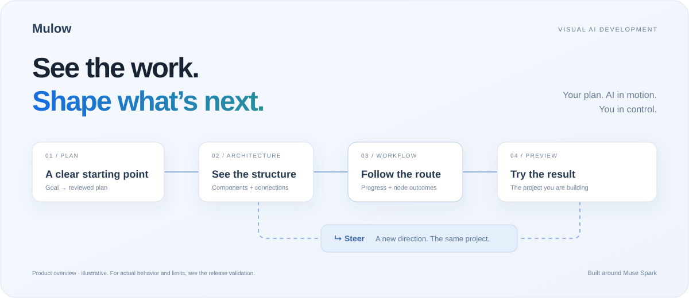

# Mulow

### See the work. Shape what’s next.

**Visual AI development, powered by Muse Spark.** Muse plans and builds. Mulow makes the work visible, connected and steerable.

[Watch the demo](#demo) · [Explore Mulow](https://mulow.vercel.app/) · [Mac Beta](https://github.com/yeon971105/Mulow/releases/tag/v7.0.7-mac-preview) · [Source](app/)

## Why Mulow

AI development can be hard to follow when the plan, current work and resulting app are scattered across a long conversation. Mulow connects them in one visual workspace so you can understand the structure, inspect progress and guide the next change.

## Muse does the work. You direct it.

| Stage | Muse’s role | What you can see and do in Mulow |
| --- | --- | --- |
| **Plan** | Develop a goal into a plan before implementation. | Review and save the plan. |
| **Architecture** | Produce the planned structure and reflect supported project changes. | Inspect components, roles and connections. |
| **Workflow** | Propose approaches, recommend a route and execute the selected path. | Follow live progress and inspect node-specific outcomes, files and elapsed time. |
| **Agent update** | Continue an existing project while preserving its original Plan. | Ask for a change and use **Steer** to guide the route at a safe work boundary. |
| **Preview & Versions** | Produce the source used by the supported preview. | Try the app and restore a linked earlier project state while retaining later history. |

Ordinary route recommendations can continue automatically. A proposal is not an execution of every alternative. Mulow shows public activity and results, not the model’s private reasoning.

## Demo

**Mulow — Meta Hackathon Demo with 11.ai · 2:23**

https://github.com/user-attachments/assets/7ce3eb6b-e432-4821-95c2-716ad967fea5

The recorded walkthrough follows **Orbit Counter**: a saved plan → first build → an Agent update adding **Add 10** and **Even/Odd** → Steer → Preview → restore the earlier version.

The diagram above and the website’s interactive overview are illustrations. Actual workflow checks are described in [the release validation notes](https://github.com/yeon971105/Mulow/releases/tag/v7.0.7-mac-preview).

## Mac Beta

**Apple Silicon · macOS 15 or later · v7.0.7**

> **Standard launch was blocked in download testing.** The browser-downloaded app matched the published hash, but macOS Gatekeeper rejected its normal launch on the verification Mac. A notarization ticket is missing. This build is ad-hoc signed, has no Developer ID signature and is not notarized. **Beta is a maturity label; it does not resolve this installation limit.** No security protection was bypassed.

[Mac app ZIP](https://github.com/yeon971105/Mulow/releases/download/v7.0.7-mac-preview/Mulow-Mac-v7.0.7-Agent-2026-11-04.zip) · [Source ZIP](https://github.com/yeon971105/Mulow/releases/download/v7.0.7-mac-preview/Mulow-Mac-v7.0.7-Agent-source-2026-11-04.zip) · [Checksums](https://github.com/yeon971105/Mulow/releases/download/v7.0.7-mac-preview/SHA256SUMS.txt)

Live AI requires your own model connection; credentials are not included. **Windows: Coming Soon.**

For developers, the [build instructions](app/README.md#build) describe the Apple Silicon toolchain, Xcode command line tools, Python 3 and Node 24.8.0. Building creates an ad-hoc signed app; it does not add Developer ID signing or Apple notarization.

## Source and verification

**Browse the [application source](app/) or download the [reviewed source ZIP](https://github.com/yeon971105/Mulow/releases/download/v7.0.7-mac-preview/Mulow-Mac-v7.0.7-Agent-source-2026-11-04.zip).**

| Directory | Contents |
| --- | --- |
| [app/mac](app/mac/) | Native Mac wrapper |
| [app/runtime](app/runtime/) | Local runtime and visual workspace |
| [app/qa](app/qa/) | Portable synthetic Agent tests |
| [app/README.md](app/README.md) | Build and test instructions |
| [app/VALIDATION.json](app/VALIDATION.json) | Recorded validation scope and limitations |
| [website](website/) | Public landing page |

The source import contains 617 files. Runtime code and vendored dependencies match the reviewed archive; private verification identifiers are omitted from its validation summary, and a `.gitignore` is added. [File manifest](docs/source-manifest.json).

The published app, source and checksum downloads match their reviewed originals. Earlier local source-build and extracted-launch checks passed; that does **not** establish a successful browser-downloaded installation. The portable synthetic subset recorded **12/12**, and the broader release record reports **114 scoped checks** with recorded fixtures. These checks do not prove every generated app or alternative works. Preview supports a restricted React profile; file import and drag-and-drop are outside this release’s scope.

## Development history and hackathon scope

This is a snapshot publication of an existing Mulow codebase, not a claim that the entire application was written during the event. The [runtime manifest](app/runtime/build.json) records upstream baseline `fbce78334a044794c2cee625ac74a0cc18aad14b`.

The release combines the existing visual-workspace/runtime foundation with the verified Agent-continuation, selected-route steering, node-outcome, linked-rewind and Mac packaging work described in [VALIDATION.json](app/VALIDATION.json). The source snapshot does not contain the original commit history or a dated event-boundary diff, so exact before/during-event attribution is **not independently established**. Public repository commit dates describe publication and maintenance, not original implementation dates. Vendored dependencies retain their own authorship and licenses.

## License

Original Mulow code is [MIT](LICENSE), copyright 2026 Jewon Yeon. Retain [third-party notices](app/THIRD_PARTY_NOTICES.txt), the [Node license](app/NODE-LICENSE.txt) and vendored license files when redistributing.

